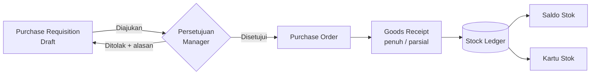
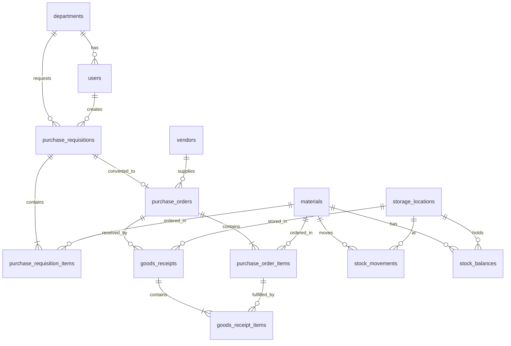

<div align="center">

# Mini ERP: Modul Pengadaan & Persediaan

**Alur *Procure-to-Stock* dari permintaan barang sampai stok masuk gudang, dengan buku besar stok yang tidak bisa diubah.**


[Demo Video](#demo) · [Fitur](#fitur) · [Aturan Bisnis](#aturan-bisnis) · [Skema Database](#skema-database) · [Menjalankan Lokal](#menjalankan-secara-lokal)

</div>

---

## Tentang Proyek

Proyek portofolio ini mensimulasikan satu proses inti yang ada di hampir semua sistem ERP: **pengadaan barang hingga masuk ke persediaan**. Fokusnya bukan banyaknya modul, tetapi **kebenaran alur dan integritas data**: persetujuan berjenjang, penerimaan barang parsial, nomor dokumen yang tidak ganda, dan saldo stok yang selalu bisa ditelusuri ke riwayat pergerakannya.

Istilah dan alur dirancang **mengacu pada konsep Procure-to-Pay pada SAP MM** (Purchase Requisition, Purchase Order, Goods Receipt, Material Document) yang disederhanakan untuk keperluan belajar. Proyek ini **bukan** SAP dan tidak mengklaim kesetaraan fitur.

> **Latar belakang.** Saya sebelumnya membangun sistem rekap kependudukan dan perencanaan pembangunan untuk Pemerintah Desa Sobang yang dipakai langsung oleh perangkat desa. Proyek ini adalah latihan menerapkan pola yang sama (validasi, aturan bisnis, jejak audit) pada domain ERP.

## Demo

> 🎥 **Video demo (±2 menit):** `[tambahkan tautan]`

| Dashboard | Purchase Requisition | Kartu Stok |
|:---:|:---:|:---:|
| `[screenshot]` | `[screenshot]` | `[screenshot]` |

## Alur Proses



## Fitur

Centang menandakan sudah selesai dan diuji. Daftar ini diperbarui seiring pengembangan.

**Master Data**
- [ ] Material, Vendor, Storage Location, Department

**Pengadaan**
- [ ] Purchase Requisition (PR) dengan status `draft → submitted → approved/rejected → converted`
- [ ] Persetujuan PR oleh Manager (penolakan wajib menyertakan alasan)
- [ ] Purchase Order (PO) dari PR yang disetujui
- [ ] Penomoran dokumen otomatis per tahun (contoh: `PR-2026-0001`)

**Gudang**
- [ ] Goods Receipt (GR), termasuk penerimaan parsial
- [ ] Stock ledger (tidak dapat diubah) dan saldo stok per material per lokasi
- [ ] Koreksi lewat reversal, bukan edit

**Laporan & Kontrol**
- [ ] Kartu stok per material dan lokasi
- [ ] Peringatan stok di bawah minimum
- [ ] Hak akses per peran: Admin, Purchasing, Warehouse, Manager
- [ ] Log aktivitas (opsional)
- [ ] Goods Issue ke departemen (opsional)
- [ ] Ekspor Excel/PDF (opsional)

## Aturan Bisnis

Aturan inilah yang menjadi inti proyek, dan masing-masing dijaga oleh test otomatis.

1. **Ledger bersifat append-only.** Baris `stock_movements` tidak pernah diubah atau dihapus. Kesalahan dikoreksi dengan baris pembalik (`REVERSAL`), sehingga seluruh riwayat bisa diaudit.
2. **Saldo selalu konsisten dengan ledger.** `stock_balances` hanya diubah lewat satu service, di dalam transaksi database dengan row locking, dan harus sama dengan `SUM(quantity)` pada ledger.
3. **PR hanya bisa diedit saat `draft`.** Hanya peran `manager` yang dapat menyetujui atau menolak.
4. **PO hanya dibuat dari PR yang `approved`**, lalu PR berstatus `converted`.
5. **GR tidak boleh melebihi sisa PO.** GR parsial membuat PO `partially_received`; PO menjadi `completed` bila semua item terpenuhi.
6. **Stok tidak boleh negatif.**
7. **Nomor dokumen tidak ganda**, dihasilkan dari tabel urutan di dalam transaksi.

## Peran Pengguna

| Peran | Kewenangan utama |
|---|---|
| **Admin** | Kelola master data dan pengguna |
| **Purchasing** | Membuat PO dari PR yang disetujui |
| **Warehouse** | Mencatat Goods Receipt, melihat kartu stok |
| **Manager** | Menyetujui atau menolak PR |

Pembuat PR (staf departemen) dapat membuat dan mengajukan PR milik departemennya. `[sesuaikan dengan implementasi akhir]`

## Skema Database



**Keputusan desain**
- **Ledger + saldo terpisah.** Ledger adalah sumber kebenaran; `stock_balances` adalah ringkasan untuk kueri cepat. Keduanya diperbarui dalam satu transaksi.
- **Kuantitas bertanda** (`+` masuk, `−` keluar) agar saldo cukup dijumlahkan.
- **Status sebagai PHP Enum**, bukan string bebas, untuk mencegah status tidak valid.
- **Urutan dokumen di tabel khusus** (`unique(type, year)`) agar penomoran aman dari konflik.

## Pemetaan Istilah ke SAP

Pemetaan ini bersifat konseptual dan disederhanakan.

| Konsep | Istilah SAP | Tabel di proyek ini |
|---|---|---|
| Data barang | Material Master | `materials` |
| Pemasok | Vendor | `vendors` |
| Gudang | Plant / Storage Location | `storage_locations` |
| Permintaan pembelian | Purchase Requisition | `purchase_requisitions` |
| Pesanan pembelian | Purchase Order | `purchase_orders` |
| Penerimaan barang | Goods Receipt | `goods_receipts` |
| Riwayat stok | Material Document | `stock_movements` |

## Tech Stack

| Lapisan | Teknologi |
|---|---|
| Backend | Laravel 12, PHP 8.2+ |
| Admin panel | Filament |
| Database | MySQL |
| Testing | Pest |
| Tooling | Git, Composer |

## Menjalankan Secara Lokal

**Prasyarat:** PHP 8.2+, Composer, MySQL (mis. via Laragon).

```bash
# 1. Kloning dan masuk ke folder
git clone https://github.com/[username]/mini-erp.git
cd mini-erp

# 2. Pasang dependensi
composer install

# 3. Siapkan environment
cp .env.example .env
php artisan key:generate
# Atur DB_DATABASE, DB_USERNAME, DB_PASSWORD di file .env

# 4. Buat tabel dan isi data contoh
php artisan migrate --seed

# 5. Jalankan
php artisan serve
```

Buka `http://localhost:8000/admin` dan masuk dengan akun demo di bawah.

### Akun Demo (hanya untuk lokal)

| Peran | Email | Password |
|---|---|---|
| Admin | `admin@mini-erp.test` | `password` |
| Purchasing | `purchasing@mini-erp.test` | `password` |
| Warehouse | `warehouse@mini-erp.test` | `password` |
| Manager | `manager@mini-erp.test` | `password` |

> Seluruh data adalah **data contoh** yang dibuat seeder. Tidak ada data perusahaan atau pribadi.

## Pengujian

```bash
./vendor/bin/pest
```

Test mencakup aturan bisnis utama:
- Nomor dokumen unik dan berurutan per tahun
- PR tidak bisa diedit setelah diajukan
- Hanya manager yang bisa menyetujui PR; penolakan tanpa alasan gagal
- PO hanya bisa dibuat dari PR yang disetujui
- GR melebihi sisa PO ditolak
- GR parsial dan penuh menghasilkan status PO yang benar
- Saldo stok selalu sama dengan jumlah ledger
- Reversal mengembalikan saldo tanpa mengubah baris lama

Hasil terakhir: `[N] test, [M] assertion, semuanya lulus` *(perbarui setelah test dijalankan)*

## Struktur Proyek

```
app/
├── Enums/              # Status dokumen dan peran
├── Filament/Resources/ # Halaman admin per entitas
├── Models/
├── Policies/           # Pembatasan akses per peran
└── Services/
    ├── StockService.php            # Satu-satunya pintu perubahan stok
    └── DocumentNumberService.php   # Penomoran dokumen
database/
├── migrations/
└── seeders/            # Data contoh
tests/Feature/          # Test aturan bisnis
```

*(Sesuaikan dengan struktur sebenarnya.)*

## Batasan Proyek

Proyek ini sengaja berfokus pada satu alur. Hal-hal berikut **tidak** dicakup:
- Keuangan, penagihan (invoice), dan akuntansi
- SDM, produksi, dan penjualan
- Multi-perusahaan dan multi-mata uang
- Integrasi dengan sistem eksternal

## Rencana Pengembangan

- [ ] Goods Issue ke departemen
- [ ] Dashboard ringkasan pengadaan
- [ ] Ekspor laporan ke Excel dan PDF
- [ ] Log aktivitas lengkap
- [ ] Dokumentasi API (jika ditambahkan)

## Pembelajaran

- Mendesain **ledger append-only** dan menjaga konsistensinya dengan saldo
- Mengamankan operasi stok dari *race condition* dengan transaksi dan row locking
- Memodelkan alur persetujuan sebagai mesin status yang tervalidasi
- Menulis test dari aturan bisnis, bukan sekadar dari halaman

## Pembuat

**M. Fikri Aulia Hasan**
Mahasiswa Informatika, Universitas Serang Raya · Serang, Banten

[LinkedIn](https://www.linkedin.com/in/m-fikri-aulia-hasan-091211376) · [GitHub](https://github.com/MFikriHasan) · mfikriauliahasan11@gmail.com

---

<div align="center">
<sub>Proyek ini dibuat untuk tujuan belajar dan portofolio.</sub>
</div>
